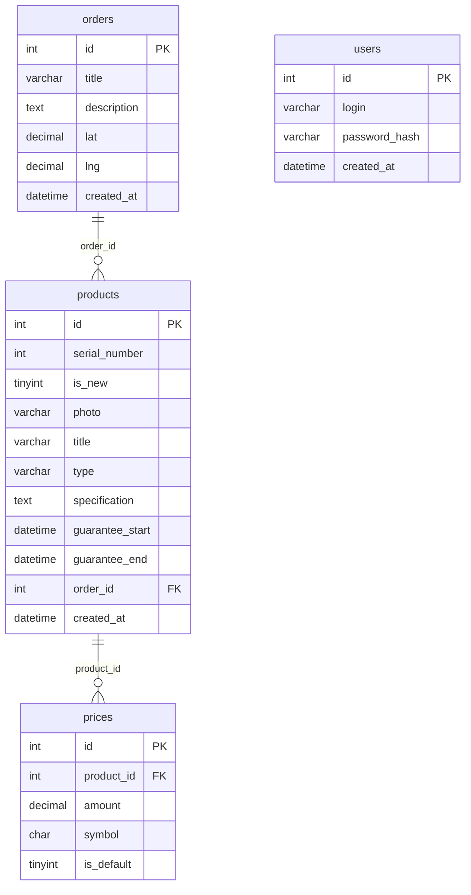

# Orders & Products

SPA-приложение «Orders & Products» — учёт приходов (Orders) и продуктов (Products). Уровень **Junior+** тестового задания «JavaScript / ReactJS».

## Что умеет приложение

| Раздел           | Возможности                                                                                                                                                                                                                                                        |
| ---------------- | ------------------------------------------------------------------------------------------------------------------------------------------------------------------------------------------------------------------------------------------------------------------ |
| **Приход**       | Список приходов: название, количество продуктов, дата в двух форматах, сумма в USD и UAH. Клик по приходу открывает рядом панель с продуктами (её можно закрыть). Добавление прихода, добавление и удаление продуктов, удаление прихода через попап подтверждения. |
| **Продукты**     | Все продукты: название, тип, даты гарантии в двух форматах, цена в двух валютах, название прихода. Фильтры по типу и по спецификации.                                                                                                                              |
| **Статистика**   | Столбчатая диаграмма сумм приходов (с выбором валюты, длинные названия обрезаются, при большом числе приходов блок прокручивается) и круговая диаграмма продуктов по типам.                                                                                        |
| **Карта**        | Приходы с координатами на карте (Leaflet + OpenStreetMap).                                                                                                                                                                                                         |
| **Пользователи** | Список пользователей (доступен после входа).                                                                                                                                                                                                                       |
| **Настройки**    | Язык интерфейса, данные аккаунта, срок действия сессии, выход.                                                                                                                                                                                                     |
| **Верхнее меню** | Дата и время в реальном времени, счётчик активных вкладок (WebSocket), поиск по приходам и продуктам, переключатель языка RU / UA / EN, вход и выход.                                                                                                              |
| **Доступ**       | Смотреть данные можно без входа. Создавать и удалять — только после входа (JWT). Демо-пользователь: `admin` / `admin123`.                                                                                                                                          |

## Технологии

React 18 · **Next.js 14 (SSR)** · **TypeScript** · Redux Toolkit · Bootstrap 5 + **БЭМ** · Socket.io · REST (fetch) ·
Express · MySQL 8 · **JWT** (jsonwebtoken, bcrypt) · **i18n** (собственная, переводы в JSON, RU/UA/EN) · **Web Storage** (localStorage) ·
**Lazy Loading** (`next/dynamic`, `loading="lazy"`) · **Charts** (Recharts) · **Maps** (Leaflet) · **Unit-тесты** (Vitest) · Docker.

## Структура

```
orders-products/
├── backend/             # Express + TypeScript: REST API, JWT, Socket.io
│   └── src/             #   index.ts (маршруты), repo.ts (SQL), auth.ts, validate.ts, db.ts
├── frontend/            # Next.js (App Router)
│   ├── src/
│   │   ├── app/         #   страницы: orders, products, stats, map, users, settings, login + layout/template
│   │   ├── components/  #   UI-компоненты
│   │   ├── store/       #   Redux: срезы (auth, orders, products, search), хуки, провайдер
│   │   ├── i18n/        #   переводы (locales/*.json) и провайдер языка
│   │   ├── api/         #   запросы к серверу (fetch) и ошибки API
│   │   ├── types/       #   общие типы (Order, Product, User ...)
│   │   ├── utils/       #   чистые функции: даты/деньги, суммы, поиск, jwt, storage
│   │   ├── hooks/       #   собственные React-хуки
│   │   └── validation/  #   правила валидации форм
│   ├── tests/           # unit-тесты (структура повторяет src/)
│   └── mock/            # тестовый API в памяти — только для запуска фронтенда без бэкенда
├── db/init.sql          # схема БД + тестовые данные
├── docs/GUIDE.md        # пошаговое руководство: что, зачем и как сделано
├── STAGE1.md            # запуск одного фронтенда (без Docker и базы)
└── docker-compose.yml
```

## Быстрый старт (Docker)

Нужно: [Docker Desktop](https://www.docker.com/products/docker-desktop/) (или Docker Engine + Compose).

```bash
git clone <URL-репозитория> orders-products
cd orders-products
docker compose up --build
```

Первый запуск занимает несколько минут (сборка образов, инициализация MySQL). Дальше:

- приложение — http://localhost:3000
- API — http://localhost:4000/api/health

Остановить: `Ctrl+C`, а `docker compose down -v` ещё и удалит данные БД.

## Быстрый старт только фронтенда (без Docker и базы)

Нужен только Node.js 20.19+. Подробности — в [STAGE1.md](STAGE1.md).

```bash
cd frontend
npm install
npm run dev:mock    # фронтенд + тестовый API с данными в памяти
```

Откройте http://localhost:3000. В этом режиме счётчик вкладок (WebSocket) отключён.

## Запуск без Docker (режим разработки)

Нужно: **Node.js 20.19+** и MySQL 8. Проще всего поднять только базу в Docker:

```bash
docker compose up db            # MySQL на localhost:3306, схема и данные загружаются автоматически
```

В двух отдельных терминалах:

```bash
# 1) бэкенд  → http://localhost:4000
cd backend
npm install
npm run dev

# 2) фронтенд → http://localhost:3000
cd frontend
npm install
npm run dev
```

Без Docker базу можно создать вручную: `mysql -u root -p < db/init.sql`, а подключение задать переменными `DB_*` (таблица ниже).

## Тесты и проверки

```bash
cd backend  && npm test && npm run typecheck     # валидация запросов
cd frontend && npm test && npm run typecheck     # форматы, суммы, поиск, валидация, JWT, i18n, Redux
cd frontend && npm run build                     # production-сборка
```

Тесты фронтенда лежат отдельно, в `frontend/tests/`.

## Переменные окружения

| Переменная                                                | Где      | По умолчанию                                           | Назначение                                                                                |
| --------------------------------------------------------- | -------- | ------------------------------------------------------ | ----------------------------------------------------------------------------------------- |
| `DB_HOST`, `DB_PORT`, `DB_USER`, `DB_PASSWORD`, `DB_NAME` | backend  | `localhost`, `3306`, `root`, `root`, `orders_products` | подключение к MySQL                                                                       |
| `JWT_SECRET`                                              | backend  | `dev-secret-change-me`                                 | ключ подписи токенов. **Измените на сервере!**                                            |
| `ADMIN_LOGIN`, `ADMIN_PASSWORD`                           | backend  | `admin`, `admin123`                                    | демо-пользователь, создаётся при первом старте                                            |
| `PORT`                                                    | backend  | `4000`                                                 | порт API                                                                                  |
| `INTERNAL_API_URL`                                        | frontend | `http://localhost:4000`                                | адрес API для SSR и прокси `/api` (в Docker — `http://backend:4000`)                      |
| `NEXT_PUBLIC_SOCKET_URL`                                  | frontend | `http://localhost:4000`                                | адрес WebSocket **для браузера** (вшивается при сборке; значение `off` отключает счётчик) |

Для Docker скопируйте `.env.example` в `.env` и измените значения.

## REST API

| Метод и путь                             | Доступ   | Описание                                         |
| ---------------------------------------- | -------- | ------------------------------------------------ |
| `POST /api/auth/login`                   | открытый | `{login, password}` → `{token, login}`           |
| `GET /api/orders`                        | открытый | приходы со вложенными продуктами                 |
| `POST /api/orders`                       | JWT      | создать приход                                   |
| `DELETE /api/orders/:id`                 | JWT      | удалить приход (продукты удаляются каскадом)     |
| `GET /api/products?type=&specification=` | открытый | продукты, опционально по типу и/или спецификации |
| `GET /api/products/types`                | открытый | список типов                                     |
| `GET /api/products/specifications`       | открытый | список спецификаций (для второго фильтра)        |
| `POST /api/products`                     | JWT      | создать продукт (с двумя ценами, в транзакции)   |
| `DELETE /api/products/:id`               | JWT      | удалить продукт                                  |
| `GET /api/users`                         | JWT      | список пользователей (без хешей паролей)         |

Защищённые запросы передают заголовок `Authorization: Bearer <token>`. Ошибки валидации возвращаются как `400 {errors: [...]}`.
WebSocket: событие `sessions` с числом подключённых вкладок.

## Схема БД

Файл `db/init.sql` (MySQL 8). Связи: `orders 1 — N products 1 — N prices`; `ON DELETE CASCADE`.



**Как открыть в MySQL Workbench:** `File → New Model → File → Import → Reverse Engineer MySQL Create Script…` → выбрать `db/init.sql` → Execute → `File → Save Model As…` (получите `.mwb` с диаграммой).

## Развёртывание на сервере (VDS)

```bash
git clone <URL-репозитория> orders-products && cd orders-products
cp .env.example .env     # изменить DB_PASSWORD, JWT_SECRET, ADMIN_PASSWORD
# PUBLIC_API_URL=http://<IP-или-домен>:4000  — адрес API, доступный из браузера (для WebSocket)
docker compose up -d --build
```

Откройте порты 3000 и 4000. Для HTTPS поставьте перед приложением nginx или Caddy; тогда `PUBLIC_API_URL` должен быть `https://…`.

## Известные ограничения

- Тайлы карты загружаются с openstreetmap.org — в браузере нужен интернет.
- Токен хранится в `localStorage` (требование задания про Web Storage). В production-проекте безопаснее `httpOnly`-cookie.
- Статус «свободен / в ремонте» из макета в данных ТЗ отсутствует, поэтому показывается признак «новый / Б/У».
- В тексте ТЗ указан один фильтр по типу, а в макете два (тип и спецификация) — реализованы оба.
- Значения типов продуктов (Monitors, Keyboards, Mice) приходят из данных и не переводятся.
